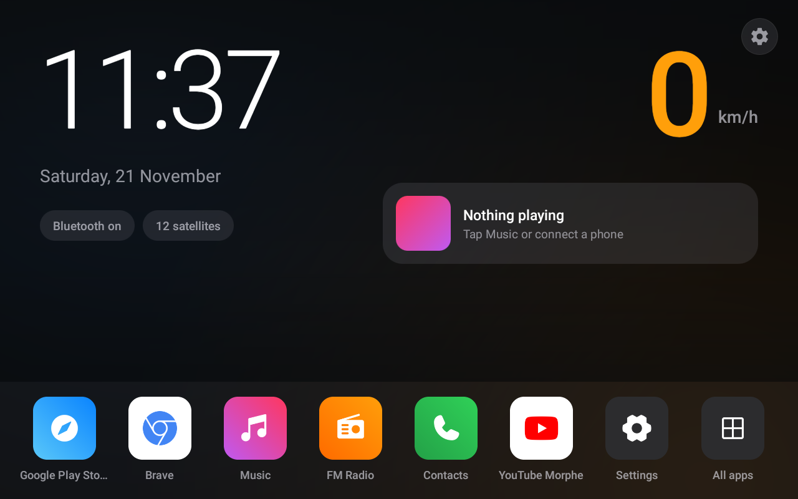
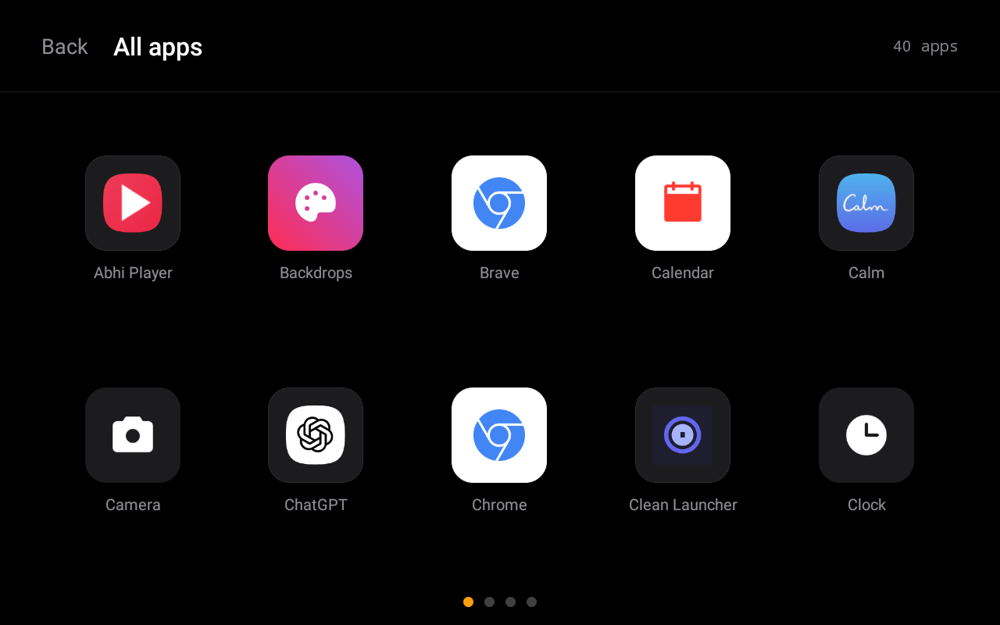
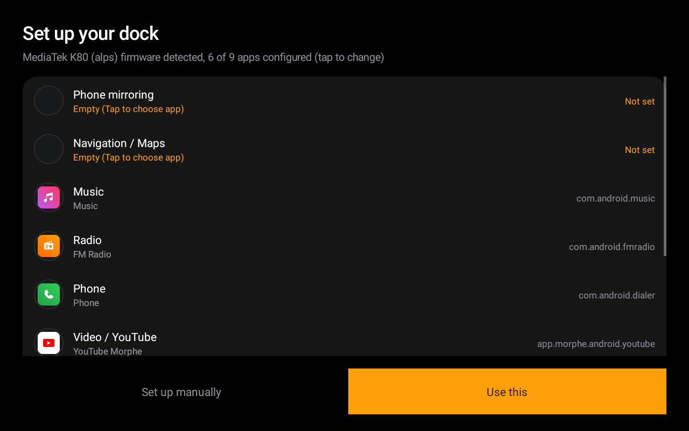
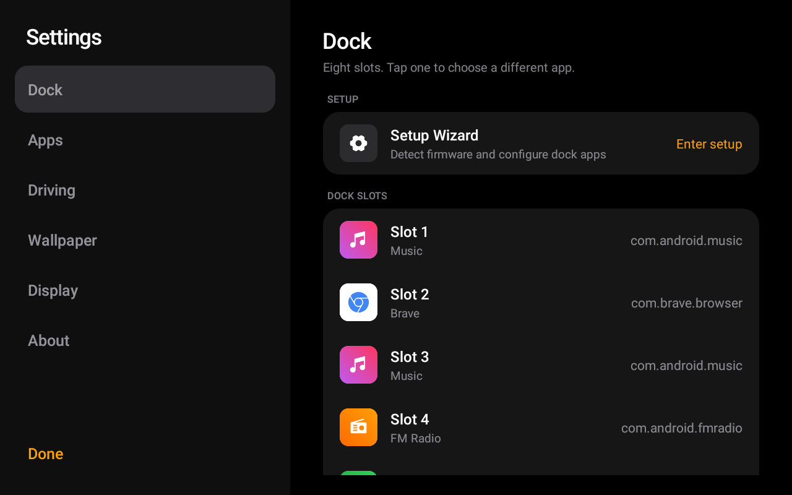

# Dash

A minimal, ultra-fast home screen for Android automotive head units and car tablets.

Built on pure Android framework APIs with **zero third-party dependencies**. It replaces bloated, sluggish vendor interfaces with a clean Apple-inspired squircle design, responsive GPS speedometer, universal media capture, and automatic hardware detection.



---

## Highlights

| Feature | Description |
|---|---|
| **Apple-Style Squircles** | 31+ clean vector squircle icons (Phosphor & SimpleIcons) with continuous squircle masks, plus dynamic Apple dark-plate (`#1C1C1E`) wrapping for any third-party app. |
| **Hardware Detection** | Automated Setup Wizard detects firmware family (MediaTek K80, Topway TS10/TS18, FYT/Teyes, Allwinner, Rockchip, MTK AC8227L) and pre-populates working apps. |
| **GPS Speedometer** | Real-time speedometer with Exponential Moving Average (EMA) smoothing ($\alpha = 0.35$), standstill deadband snap, and displacement fallback for GPS chips without Doppler velocity. |
| **Universal Media Card** | Captures playback, track titles, album art, and controls from `MediaSessionManager`, media notifications, and Bluetooth A2DP. |
| **Journey Trip Computer** | Tracks distance, moving average speed, max speed, and duration. Survives ignition power cycles and ends only after 3 hours parked. |
| **Drive Mode** | Simplifies to large touch targets above 30 km/h with dominant speed display; automatically returns below 18 km/h. |
| **Custom Dock & Icon Picker** | Long-press any slot to assign any installed app or pick dedicated Apple vector icons. |
| **Ambient & Idle Dimming** | Automatic night dimming by clock and idle screen dimming after inactivity. Long-press clock for instant screen off. |

---

## Specifications

| Metric | Value |
|---|---|
| **APK Size** | **~1.3 MB** (unminified debug) |
| **Third-Party Dependencies** | **0** (No Compose, No Material, No AppCompat) |
| **Resident Memory** | **~75 MB** |
| **OS Compatibility** | **Android 8.1+ (API 27+)** through Android 14+ (targetSdk 30) |
| **Display Support** | Landscape 1024x600, 1280x720, 1280x800, and widescreen head units |
| **Language** | Kotlin / Clean Android SDK Architecture |

---

## Screens

| Home Screen | App Drawer |
|---|---|
|  |  |

| Setup Wizard (Hardware Detection) | Dock & Custom Icons |
|---|---|
|  |  |

---

## Supported Head Unit Platforms

Dash detects and pre-configures working apps out of the box for major Android automotive families:

- **MediaTek K80 BSP (`alps k80_bsp` / `full_k80_bsp` / `MT6580`)**: Budget car tablets & head units with MediaTek radio and ZLink.
- **Topway (TS10 / TS18 / TS7)**: UIS7862 platforms (`com.ts.main`, `com.ts.radio`, `com.ts.music`).
- **FYT / UIS7862 / Teyes (CC2 / CC3 / Spro / Joying / Mekede)**: SYU ecosystem (`com.syu.ms`, `com.syu.radio`, `com.syu.music`, `com.syu.canbus`).
- **Allwinner (T3 / T507 / T8)**: Auto chips (`com.aw.radio`, `com.aw.music`).
- **Rockchip (PX5 / PX6 / RK3399 / RK3326 / HCT)**: Dasaita, Eonon, Xtrons (`com.hct.radio`, `com.microntek.music`).
- **MTK AC8227L / AC8257**: AutoChips platforms (`com.autochips.radio`, `com.autochips.music`).
- **Generic Android 8.1+**: Automatic heuristic discovery for any Android device.

---

## Installation

### 1. Enable Developer Options on Head Unit
Go to **Settings → About → tap Build Number 7 times**.
If prompted for a password, common manufacturer codes are:
- `8888`, `3368`, `1234`, `0000`, `1617`
- On Rockchip/Android 11 units, try the current date followed by three capital `O`s: e.g. `20261121OOO`.

### 2. Connect via ADB
Connect via USB debugging or over Wi-Fi (Phone hotspot works well):

```bash
# Pair device (if wireless debugging is used)
adb pair <ip>:<pairing-port> <pairing-code>
adb connect <ip>:<connect-port>
```

### 3. Install APK
```bash
adb install -r app-debug.apk
```

### 4. Grant Permissions
```bash
# GPS Speedometer
adb shell pm grant com.debashis.carlauncher android.permission.ACCESS_FINE_LOCATION

# Media Session Access (captures title, artist, art, and controls)
adb shell cmd notification allow_listener \
  com.debashis.carlauncher/com.debashis.carlauncher.DashNotificationListener
```

### 5. Set as Default Launcher
Press the **Home** button on your head unit and select **Dash**, or configure in **Settings → Apps → Default Apps → Home App**.

---

## Build from Source

```bash
git clone https://github.com/abhis699/dash-car-launcher.git
cd dash-car-launcher
./gradlew assembleDebug
```

Built APK will be located at: `app/build/outputs/apk/debug/app-debug.apk`.

Requires **JDK 17** and **Android SDK 34**.

---

## License

MIT License. Free for personal and automotive use.
